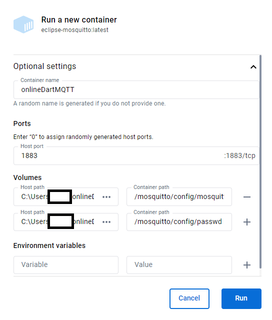
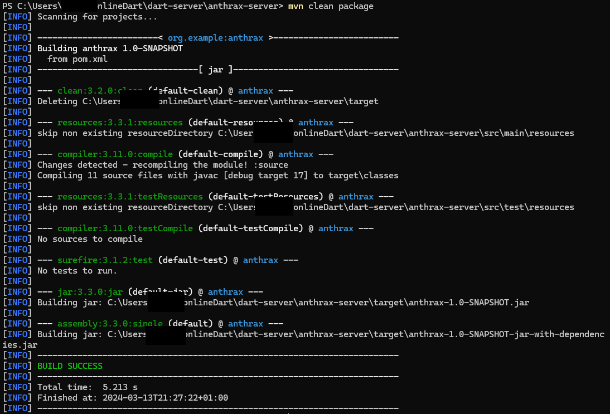
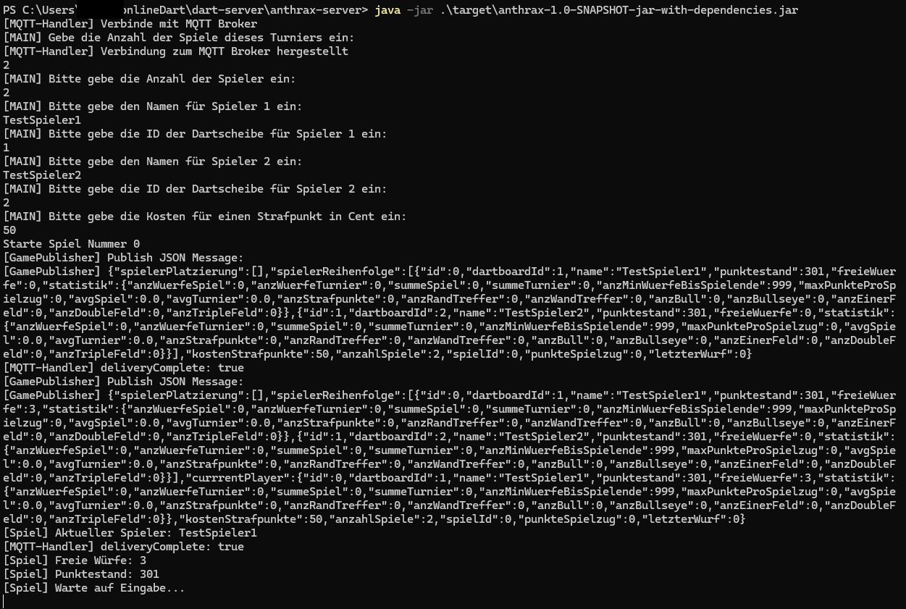

# Installation und How To Use

Für den **onion-server** (Standard) und die SteamOS-App gibt es eigene Anleitungen:
[onion-server](../dart-server/onion-server/README.md#schnellstart) ·
[dart-steamos](../dart-steamos/README.md). Diese Seite beschreibt Broker, Connectoren, die
älteren Clients und den Anthrax-Server.

## Software Requirements
### dartBlueMQTTConnector
Python 3.9.7  
paho-mqtt 1.6.1  
bleak 0.21.1  
async-timeout 4.0.3  

### dartAndroidMQTTConnector
Android 10 (Android Q, minSdk 29)

### Dart-Broker
Docker  
eclipse-mosquitto-latest

### Dart-Server-Anthrax
openJDK 17.0.8.1 2023-08-24  
Maven 3.9.6

### Dart-Client-webapp
Browser mit Javascript

## Dart-Broker
Entweder habt ihr schon einen MQTT Broker am laufen oder ihr benötigt dafür Docker[^12]   
Das Image `eclipse-mosquitto:latest` herunterladen  
Container Optional settings anpassen und starten:  
`Ports: 1183 und 8083`  
`(Pfad zum Ordner)/online-Dart/dart-broker/mosquitto.conf:/mosquitto/config/mosquitto.conf`  
`(Pfad zum Ordner)/online-Dart/dart-broker/passwd:/mosquitto/config/passwd`  
  

Alternativ über die Kommandozeile mit  
```
docker run -p 8083:8083 -p 1883:1883 -v C:/(Pfad zum Ordner)/onlineDart/dart-broker/mosquitto.conf:/mosquitto/config/mosquitto.conf -v C:/(Pfad zum Ordner)/onlineDart/dart-broker/passwd:/mosquitto/config/passwd --name dartMQTTbroker eclipse-mosquitto:latest
```
Zum testen könnt ihr einen MQTT Client ausführen und Nachrichten an den Broker schicken[^14].

Zugangsdaten und Topics: [Protokoll & Schnittstellen](protokoll.md).

## Dart-Client
### Dart-Client-Webapp
`index.html` mit einem Editor öffnen und die MQTT Broker Daten und die ID eintragen  
`index.html` mit einem Browser öffnen

## Dart-Server
Es gibt unterschiedliche Serverimplementierungen, aus denen ihr auswählen könnt. Derzeit existieren nur Server in JAVA.     
### Onion
Siehe [onion-server README](../dart-server/onion-server/README.md).
### Anthrax
Dafür benötigt ihr openjdk[^16] (getestet mit Version 17.0.8.1 2023-08-24) und maven[^13]  
Im anthrax-server eure mqttbroker.conf Datei anpassen  
`mqtt_broker_ip:IP.ADRESSE.BROKER.EINTRAGEN`  
`mqtt_broker_port:1883`  
`mqtt_username:dartboard`  
`mqtt_password:smartness`  
`mqtt_qos:0`  
Der QoS kann nicht besser sein, als er auf dem Topic published wird. In dem Fall muss in dem Dartboard-Connector der QoS entsprechend eingestellt sein.

Mit dem Befehl im Projektordner 
```
mvn clean package
```
den Server kompilieren.  
  
#### Option A mit JVM starten
Anschließend mit folgendem Befehl den Server starten  
```
java -jar .\target\anthrax-1.0-SNAPSHOT-jar-with-dependencies.jar
```  

#### Option B mit Docker starten
in das Verzeichnis `/online-Dart/dart-server/anthrax-server` wechseln und das Terminal öffnen, um das Image zu bauen.  
```
docker build -t anthrax-server-container .
```
Anschließend ausführen:
```
docker run -i -p 1884:1883 --name anthrax-server anthrax-server-container
```
Da der Hostport 1883 vom MQTT Broker belegt ist, wählen wir hier den 1884.   
Zukünftig lässt sich der Server mit folgendem Befehl starten.
```
docker start -i anthrax-server
```
 Das -i ist wichtig, damit die Spielparameter eingestellt werden können.  
Ps.: Das Server Image lässt sich folgend exportieren.
```
docker save -o anthrax_server_image.tar anthrax-server-container
```
Und mit diesem Befehl importieren: 
```
docker load -i mein_server_image.tar
```

#### Parameter setzen
Und die Einstellungen in der Kommandozeile des Turniers setzen:  
`Anzahl Spiele Turnier`  
`Anzahl Spieler`  
`Name Spieler`  
`Dartboard ID des Spielers`  
`Kosten für einen Strafpunkt in Cent`  
  

Der Server ist gestartet und das Spiel beginnt mit dem ersten Spieler.  

## Dart-Board-Connector
Wahl zwischen bluetoothfähigen Laptop/PC (python Skript) oder Android Telefon (Java App).
Der onion-server kann sich unter Linux auch selbst mit dem Board verbinden.
### DartblueMQTTConnector
Ihr benötigt für den Dart-Board-Connector ein Bluetooth fähiges Gerät und Python in der Version `3.9.7`[^17]  
Zusätzlich müsst ihr die erforderlichen Bibliotheken über PIP installieren  
Dafür führt ihr folgenden Befehl im Verzeichnis `online-Dart\dart-board-connector\dartBlueMqttConnector` aus:  
```
pip install -r requirements.txt
```  

Im DartBlueMqttConnector die Configfiles anpassen. Welche genauen Werte ihr für euch dort eintragen müsst, findet ihr unter [Reverse Engineering](reverse-engineering.md)   
-Mac-Adresse  
-Notification-UUID von der Dartscheibe  
-Dartboard ID  
-MQTT Broker Zugangsdaten.  

Dartscheibe einschalten.  
Mit folgendem Befehl den Connector starten:  
```
python dartBlueMqttConnector.py
```  
### DartAndroidMQTTConnector
Entweder mit Android Studio öffnen und auf das Handy übertragen oder das APK aus den [GitHub-Releases](https://github.com/GittiMcHub/online-dart/releases) (`android-connector-v…`) auf dem Handy installieren. Die App ist im grunde selbsterklärend: MQTT Broker und Dartboard Einstellungen anpassen und die Buttons drücken.  

## Troubleshooting
Wenn ihr Online gegeneinander spielt, achtet darauf, dass ihr euren Router und eure Firewall entsprechend konfiguriert. Auch wenn ihr den MQTT Broker auf einem anderen PC im LAN laufen lasst, kann es u.U. nötig sein die Firewall Einstellungen anzupassen.

[^12]: Docker installieren:  
https://docs.docker.com/engine/install/  
[^13]: Maven Installieren:  
https://maven.apache.org/install.html  
[^14]: MQTT Explorer zum Testen:  
http://mqtt-explorer.com/
[^16]: OpenJDK:  
https://openjdk.org/install/  
[^17]: Python:  
https://www.python.org/downloads/  
