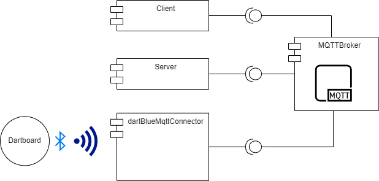
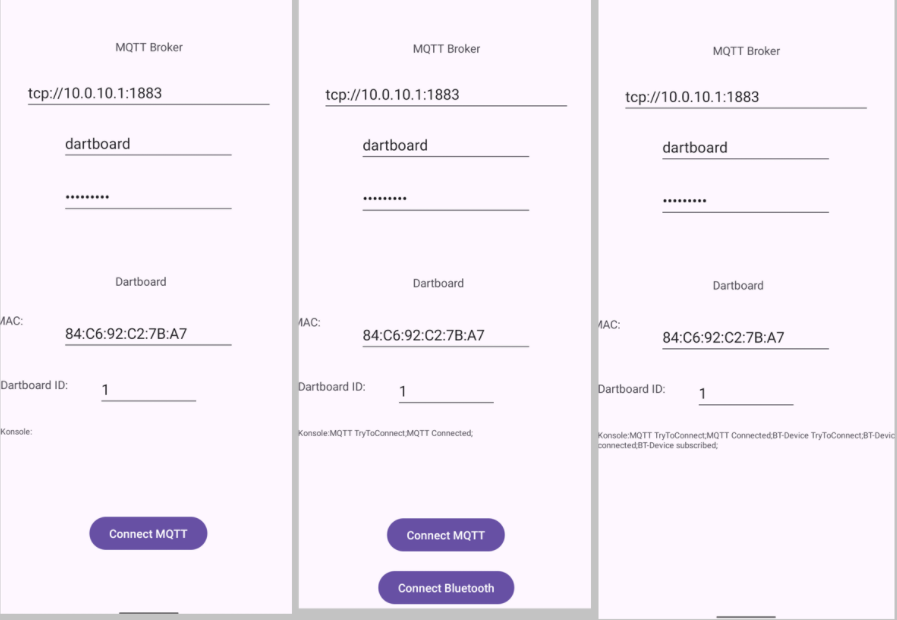
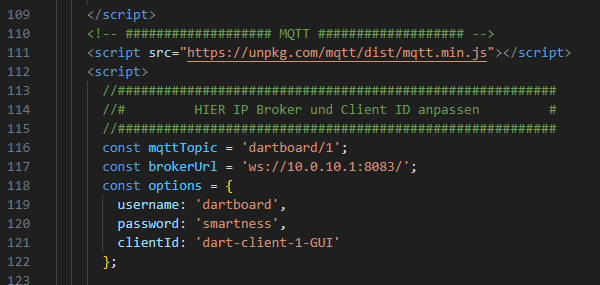
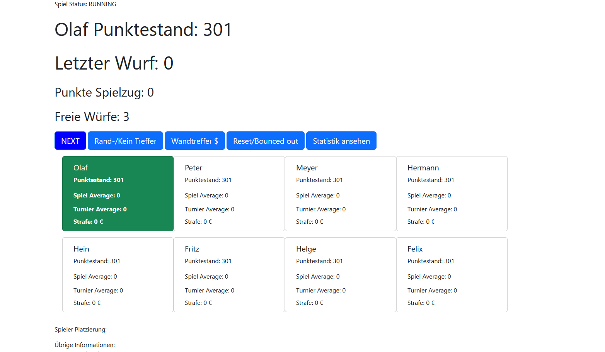
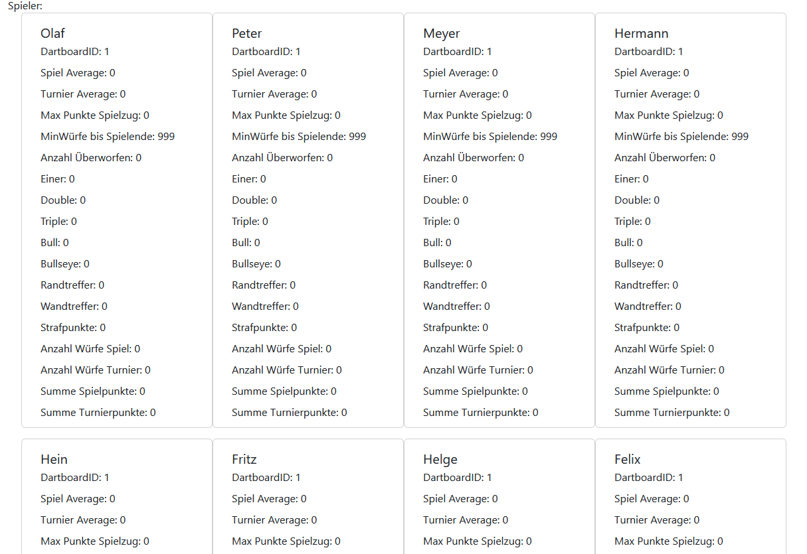
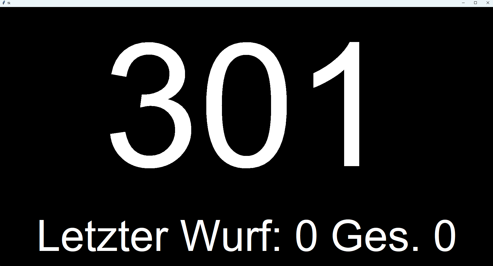
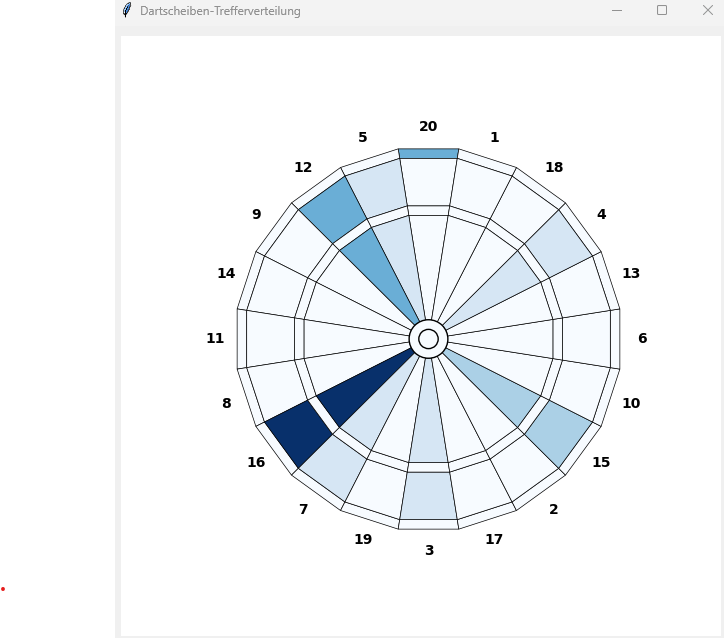
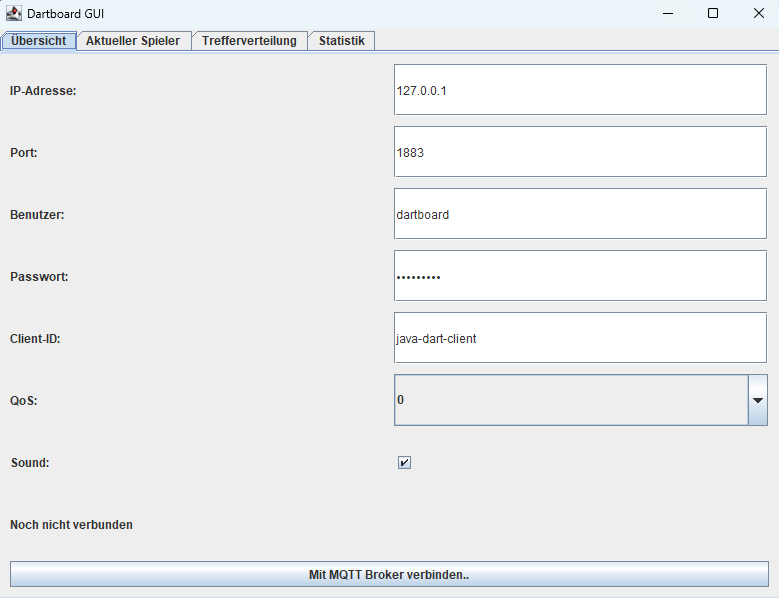
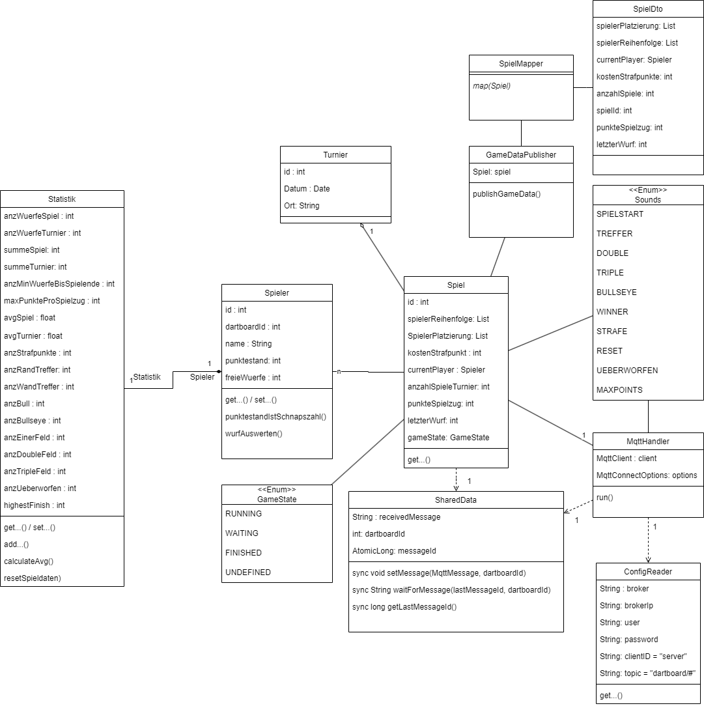
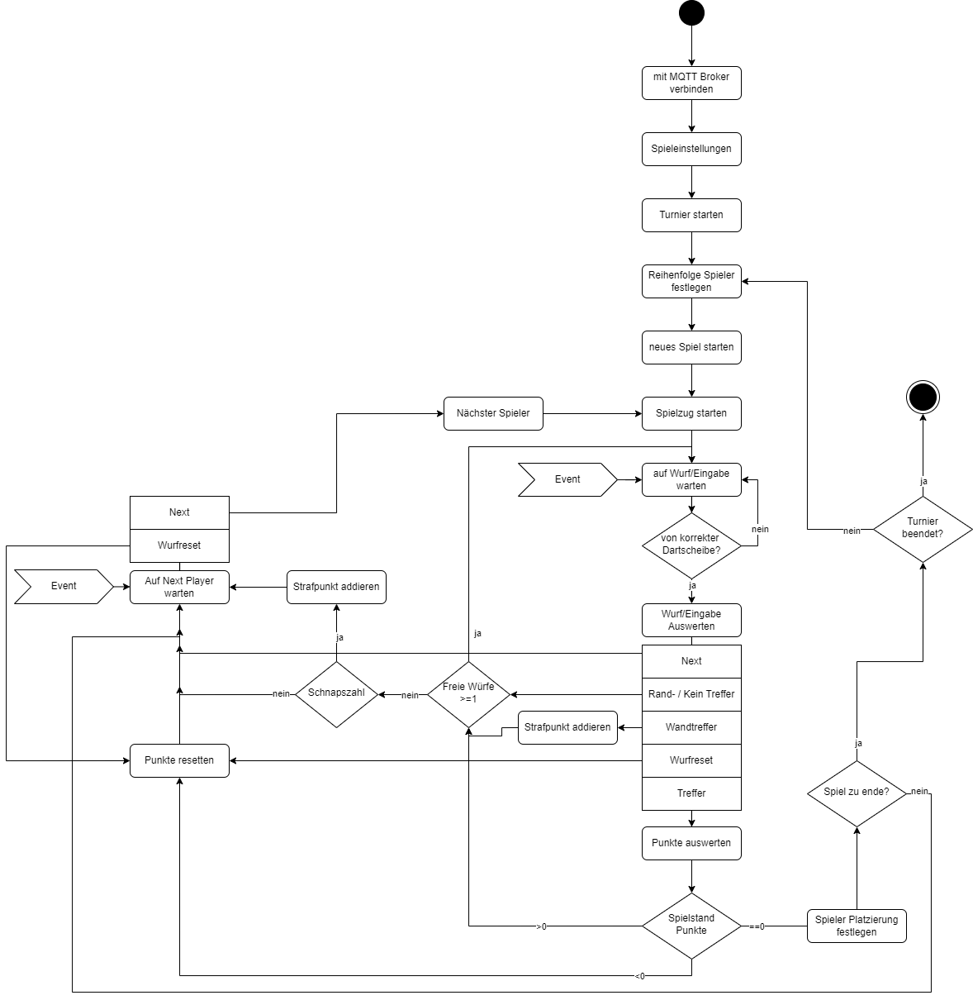

# Funktionsübersicht der enthaltenen Softwarekomponenten

## dart-board-connector
### dartBlueMqttConnector
Diese in Python geschriebene Komponente verbindet sich via Bluetooth LE mit der Dartscheibe und übersetzt die betätigten Tasten (Hex Werte) der Dartscheibe in einen String um (siehe [Dartboard Value Übersetzung](protokoll.md#dartboard-value-übersetzung-interface)). Anschließend wird der String an einen MQTT-Broker published. Unter `config` müsst ihr die MAC und UUID des Dartboards angeben, sowie die Daten für den MQTT Broker. 
Außerdem müsst ihr die Dartboard ID eingeben. Diese Nummer könnt ihr frei wählen.  
Im Server müsst ihr zu jedem Spieler auch die Dartboard ID angeben. Alle Spieler und Dartscheiben können die selbe Dartboard ID nutzen (immer, wenn es nur eine Dartscheibe für das Spiel gibt). Wenn mehrere Dartscheiben für das Spiel zur Verfügung stehen, dann können unterschiedliche Dartboard IDs vergeben werden. Das hat den Vorteil, dass die Eingaben von Darscheibe 1 nicht für Spieler zählen, die der Dartscheibe 2 zugeordnet sind. 
Details: [README](../dart-board-connector/dartBlueMqttConnector/README.md)
### dartAndroidMqttConnector
Diese Android App ist die Alternative zur in Python geschriebenen Komponente.
Details: [README](../dart-board-connector/dartAndroidMqttConnector/README.md)  
 

## dart-broker 
Hier findet ihr die vorkonfigurierte mosquitto.conf und passw-Datei für das eclipse-mosquitto Docker-Image.

## dart-client
### webapp-client
Leider sind wir keine Webentwickeler und es ist sehr primitiv: Ein Webclient für den Anthrax Server. Die `index.html` einfach mit dem Browser öffnen. Der Javascript-Spagetthi Code muss noch angepasst werden:  
  
Ein MQTT Client wird im Browser gestartet und empfängt die Gamedaten vom Anthrax Server und zeigt diese an. Die Buttons werden an den Server .  
  
Die Statistik-Seite

### currentPlayerPoints-client
Falls die Anzeige für die aktuellen eigenen Highscore zu klein ist, lässt sich dies auf einem anderen Monitor darstellen  

### currentPlayerHitpic-client
Für Übungszwecke mittels Benutzer für verschiedene Felder und versuchen beim jeweiligen Benutzer die Felder zu treffen, lassen sich zum aktuellen Player das Wurfbild anzeigen. Zwischen inner und outer Single Feldern wird derzeit nicht unterschieden.  
  
### java-ui-client
Vereint currentPlayerPoints, currentPlayerHitpic und die Statistik Seite in eine Javaanwendung. Mit MQTT Config zur Laufzeit statt Configfile.  
  

## dart-server
### Onion (Standard)
Der aktuelle Server: Spielmodi X01 (mit Double-In/-Out) und Cricket, Hausregeln, Web-Verwaltung, Lobby über MQTT, Bluetooth direkt in Java, TV-Oberfläche und [Bots](bot.md). Betriebsmodi Server, Client oder beides.
Details: [onion-server README](../dart-server/onion-server/README.md)
### dart-steamos
Packt den onion-server mit der TV-Oberfläche als AppImage für SteamOS / Steam Deck.
Details: [dart-steamos README](../dart-steamos/README.md)
### Anthrax
Der Vorgänger, ein in Java implementierter Server, der sich auf die Dartboards subscribed und die Gamedaten published. Die MQTT Config muss angepasst werden.
* Start Punktestand eingeben (301 oder 501... Frei wählbare Zahl) (Einzig mögliche Spielvariante)
* Double in/Double out NICHT implementiert/auswählbar
* Anzahl Spiele des Turniers
* Spielernamen und zugehörige Dartboard ID setzen
* Kosten der Strafpunkte vergeben. -> Bei Schnapszahl am Ende des Zuges (außer bei Überworfen oder Reset) kostet 1 Strafpunkt

Klassendiagramm:

Spielablauf:

## tools
* [`buildOwnSmartboard`](../tools/buildOwnSmartboard) — alte Dartscheibe mit Raspberry Pi smart machen
* [`bluetoothExplorer`](../tools/bluetoothExplorer) — Skripte aus dem [Reverse Engineering](reverse-engineering.md)
* [`virtualDartboard`](../tools/virtualDartboard), [`offlineClient`](../tools/offlineClient)
