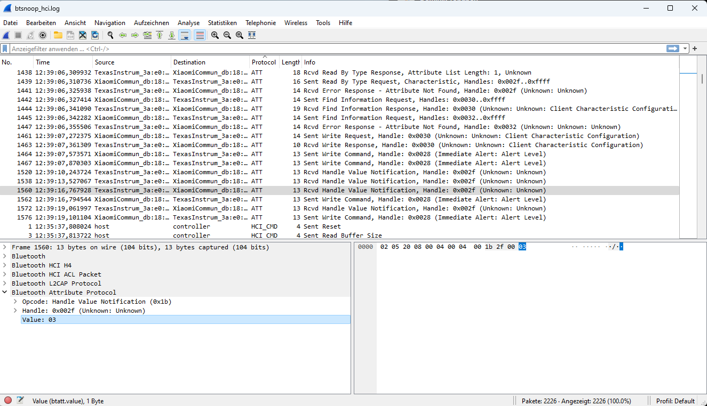
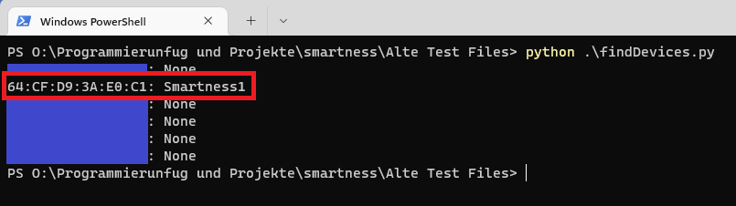
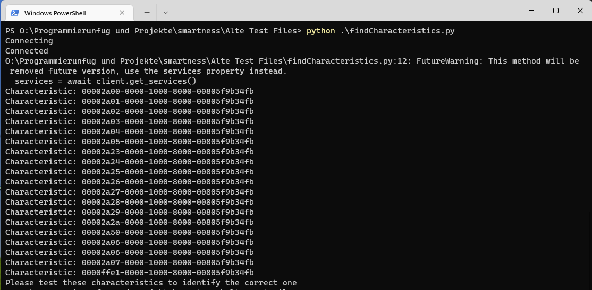
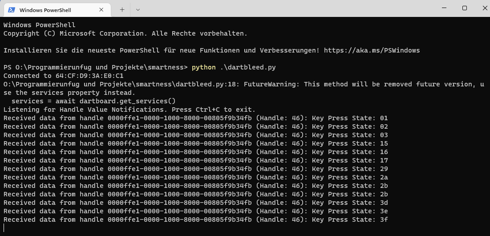

# Reverse Engineering eines smarten Dartboards
Zuerst habe ich mir den Beitrag von Hackernoon durchgelesen [^5].  
Die Android Plattform-tools[^6], ein Android Telefon und Wireshark[^9] benötigt ihr nicht zwingend, nachdem ihr dieses Kapitel gelesen habt, aber soll hier vollsätndigkeitshalber erwähnt werden.  
Anschließend habe ich mir ein Android Telefon ausgeliehen, die Entwickleroption + HCI Bluetooth Log aktiviert und die Smartness App (IOS[^7]) (Android[^8]) aufs Handy geladen.  
Die smarte Dartscheibe eingeschaltet, die App geöffnet, mit der Dartscheibe verbunden und 3 Felder auf der Dartscheibe gedrückt.  Es ist sinnvoll den genauen Zeitstempel, wann ihr gedrückt habt, zu notieren, damit ihr hinterher im Log es einfacher habt zu suchen.  
Danach das Telefon am Rechner angeschlossen und folgenden Befehl ausgeführt:  
```
adb bugreport dart_bluetooth_report
```  
Den Bugreport kann man anschließend entpacken und unter dem Verzeichnis (zumindest in meinem Fall, wenn ihr Probleme habt schaut hier[^10]) `FS/data/misc/bluetooth/logs` mit Wireshark geöffnet.  
Im Log sind mir dann 3 Nachrichten aufgefallen, die direkt hintereinander standen und ich vermutete, dass es sich hier um meine 3 gedrückten Felder handelt:  
  

Da dort als Value "3" angegeben war und darüber die Nachrichten die Werte 51/52 bin ich davon ausgegangen, dass ich hier mein Bullseye, Bull und die 3 gefunden habe. Wie sich herausstellte waren es Hex-Zahlen. Ich wusste nun auch die MAC Adresse der Dartscheibe und dass diese eine "Handle Value Notification" sendet.  
Anfänglich konnte ich mich mit der Bleak Bibliothek mit der Dartscheibe verbinden, allerdings habe ich keine Werte empfangen. Dies lag daran, dass ich mich nicht auf einer UUID vom Bluetooth Gerät subscribed habe.  
Alternativ könnt ihr auch 
```
python src/bluetoothExplorer/findDevices.py
```
ausführen und die MAC Herausfinden:  
  

Dank ChatGPT[^11] habe ich dann ein Skript genommen, was mir die UUIDs aus dem Bluettoth Gerät ausgibt.  
```
python src/bluetoothExplorer/findCharacteristics.py
```  
  

ChatGPT hat mir dann auch vorgeschlagen, welche UUID ich benutzen soll (Woher ChatGPT das weiß, weiß ich nicht, ich habe auch keine anderen UUIDs ausprobiert. Hauptsache es funktioniert :), denn tiefer habe ich mich mit dem Bluetooth Protokoll nicht beschäftigt.)  
Wenn ihr nun die MAC und die UUID habt, habe ich mich mit folgendem Skript verbunden und konnte anschließend jedes Feld der Dartscheibe drücken und die Tabelle unter [Smart Dartboard Übersetzungstabelle](protokoll.md#smart-dartboard-übersetzungstabelle) erstellen.   
Spaßeshalber habe ich es "dartbleed" genannt. Die MAC und UUID müsst ihr an eure Dartscheibe anpassen:  
```
python /src/bluetoothExplorer/dartbleed.py
```  
  

Dadurch habe ich auch herausgefunden, dass jedes Feld einzeln abgefragt wird. Bei alten Dartscheiben sind manchmal die 1x Felder zusammengefasst (siehe [hier](../tools/buildOwnSmartboard)). Für weitere Informationen zum Thema Bluetooth sind unten zu finden[^15].

Die Skripte liegen heute unter [`tools/bluetoothExplorer`](../tools/bluetoothExplorer).

[^5]: Bluetooth Geräte Reverse Engineering:  
https://hackernoon.com/de/Reverse-Engineering-von-LED-Leuchten-mit-Python%2C-um-Ihren-Computermonitor-in-einen-Umgebungsmonitor-umzuwandeln  
[^6]: Android Plattform Tools:  
https://developer.android.com/tools/releases/platform-tools  
[^7]: Original Smartness App IOS:  
https://apps.apple.com/de/app/smartness-electronic-dartboard/id1239487436  
[^8]: Original Smartness App Android:  
https://play.google.com/store/apps/details?id=com.evisionhk.smartness&hl=de&gl=US  
[^9]: Wireshark:  
https://www.wireshark.org/download.html  
[^10]: Android HCI Snoop Log (Bei Problemen):  
https://stackoverflow.com/questions/28445552/bluetooth-hci-snoop-log-not-generated  
[^11]: Bei Fragen:  
https://chat.openai.com  
[^15]: Thema Bluetooth Informationen:  
http://docwiki.embarcadero.com/RADStudio/Sydney/de/Verwenden_von_Bluetooth_Low_Energy  
https://www.golem.de/news/golem-de-programmiert-bluetoothle-im-eigenbau-1404-105896.html  
